<p align="center"></p>

<h1 align="center">HausPanel</h1>

<p align="center"><b>Un tableau de bord Home Assistant qui se construit tout seul à partir de vos pièces.</b><br>
Pour la tablette murale, le téléphone dans la poche et un écran pour les caméras.</p>

<p align="center">
  <a href="https://github.com/alpacalabs-de/hauspanel/actions"></a>
  <a href="https://github.com/alpacalabs-de/hauspanel/releases"></a>
  
  <a href="https://hacs.xyz"></a>
  
</p>

<p align="center"><br><sub>Ouvrir une pièce, régler tous ses volets d'un seul curseur, voir ce qui est ouvert, afficher toutes les pièces. (Données de démonstration.)</sub></p>

Home Assistant connaît déjà votre maison : quelles pièces sont à quel étage, et où se trouvent chaque lampe, chaque thermostat et chaque serrure. HausPanel part de ce plan et en fait des écrans lisibles d'un coup d'œil, depuis le couloir comme depuis le canapé. Quand vous ajoutez un appareil à une pièce, il apparaît tout simplement dans cette pièce. L'intégration tourne sur votre propre Home Assistant et ne communique avec rien d'autre, sauf avec Open-Meteo pour les prévisions lorsqu'aucune de vos entités météo n'en fournit (elle envoie alors la position de votre maison).

Gratuit et open source (MIT), réalisé par [Alpaca Labs](https://alpacalabs.de). *English: [README.md](README.md).*

**Sommaire :** [Trois panneaux](#trois-panneaux) · [Fonctions](#fonctions) · [Fenêtres des appareils](#des-fenêtres-pour-vos-appareils) · [Réglages](#réglages) · [Installation](#installation) · [Premiers pas](#premiers-pas) · [Questions fréquentes](#bon-à-savoir) · [Développement](#développement) · [Soutenir](#soutenir)

## Trois panneaux

L'installation de l'intégration ajoute trois entrées dans la barre latérale de Home Assistant. Chacune a ses propres réglages : la tablette murale et le téléphone peuvent donc afficher des choses différentes.

| Panneau | Conçu pour | Ce que vous obtenez |
|---|---|---|
| **HausPanel** | Tablettes murales, ordinateurs | Accueil avec pastilles d'état, pièces, multimédia, sécurité, énergie et vos propres pages. Dispositions : Panneau, Tuiles, Lignes, Barre latérale. |
| **MobilePanel** | Téléphones | Barre d'onglets en bas, pièces par étage, une pièce s'ouvre en volet, retour par glissement. |
| **SecurityPanel** | Un petit écran tactile, par exemple un Raspberry Pi en 1024×600 | Des pages de caméras en direct, puis une page d'état avec les serrures, les portes et les alarmes. Seule la page affichée diffuse le flux. |

<table>
  <tr>
    <td width="25%">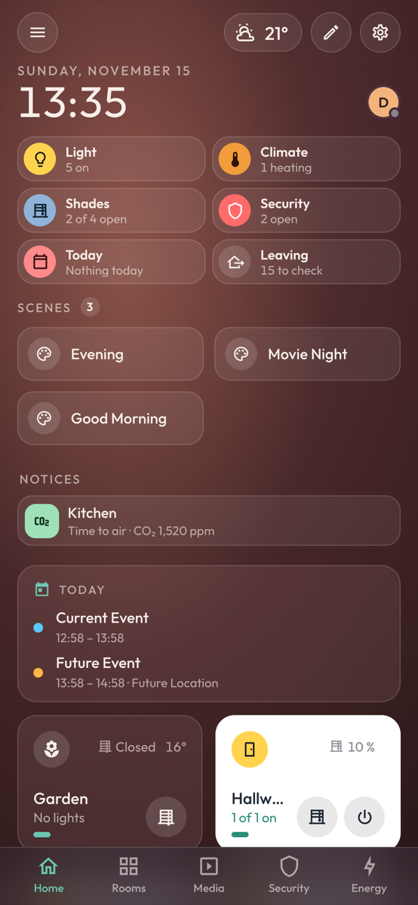</td>
    <td width="25%">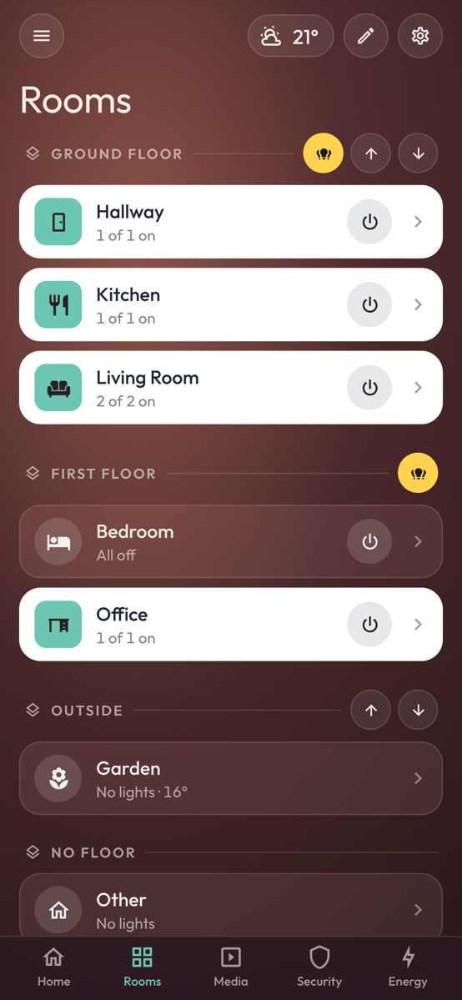</td>
    <td width="25%">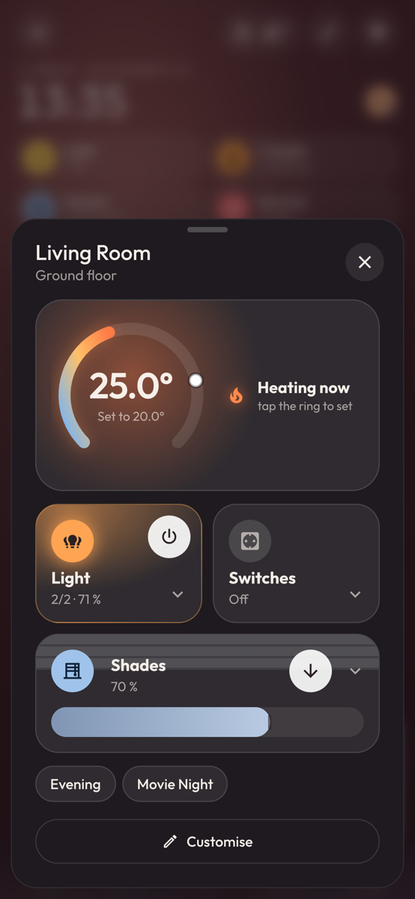</td>
    <td width="25%">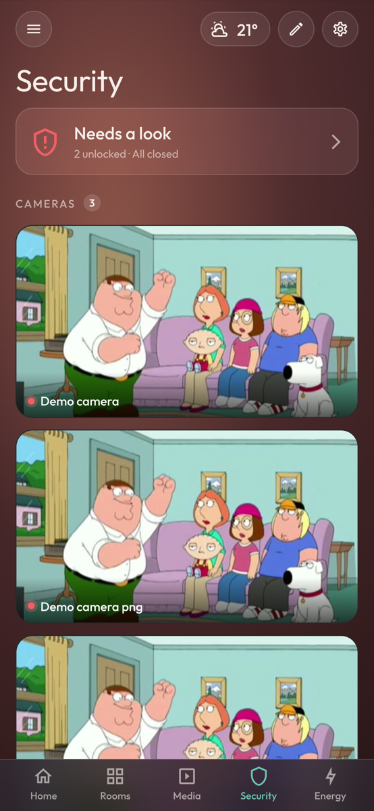</td>
  </tr>
  <tr>
    <td><sub>Accueil : pastilles, scènes, aujourd'hui, pièces</sub></td>
    <td><sub>Pièces par étage, toutes de la même taille</sub></td>
    <td><sub>Une pièce en volet</sub></td>
    <td><sub>Ce qui est ouvert, l'alarme, tout verrouiller</sub></td>
  </tr>
</table>

## Fonctions

**Se construit tout seul**

- Zones → appareils → entités : chaque pièce a ses propres tuiles, triées dans cet ordre : chauffage, lumières, prises, le reste.
- Les étages regroupent les pièces ; les zones extérieures sont reconnues.
- Mode édition pour déplacer, masquer, ajouter, regrouper sous des titres, élargir ou agrandir les tuiles, et remettre une pièce dans son ordre par défaut.
- Masquage de types d'appareils entiers, d'intégrations, d'entités selon un texte, ou une par une.

**Écran d'accueil**

- **Pastilles d'état** pour la lumière, le climat, les volets, la sécurité, l'énergie, la journée, les déchets, les colis, l'entretien et le départ de la maison. Un appui ouvre une fenêtre avec le détail. Chaque pastille peut être désactivée.
- **Les scènes demandent confirmation** : le premier appui arme, le second lance. Ainsi *Bonne nuit* ne démarre jamais par erreur.
- Carte **Aujourd'hui** avec les événements de vos calendriers et listes de tâches.
- Deux styles d'accueil : chaque pièce sous forme de carte, ou *allumé maintenant + favoris*.
- **Avis** : choisissez une entrée, un interrupteur ou un capteur à vous (*Le courrier est arrivé*, *Lessive terminée*). Il s'affiche sur l'accueil seulement lorsqu'il est activé ou dans les états que vous indiquez. Une entrée se remet à zéro avec sa coche.
- **Fenêtre ouverte, chauffage allumé** : un avis sur l'accueil pour chaque pièce où une fenêtre est ouverte pendant que le chauffage fonctionne. Un appui ouvre le thermostat.
- **Il est temps d'aérer** : un avis pour chaque pièce à 1 400 ppm de CO₂ ou plus, ou à 70 % d'humidité ou plus, sauf si une fenêtre est déjà ouverte.
- **Colis** en cours d'acheminement, issus des [intégrations de suivi de colis](https://ha-parcel-integrations.github.io/) : une pastille d'état sur l'accueil avec l'expéditeur, le transporteur, le statut et l'heure de livraison.

**Pièces**

- Un appui sur une pièce ouvre la **fenêtre de la pièce** : un anneau de température, de grandes tuiles pour la lumière, les volets, la musique et les interrupteurs, les appareils et les scènes de la pièce. Dans *Personnaliser*, vous choisissez les sections ouvertes par défaut.
- Les tuiles de lumière s'allument et s'éteignent avec leur icône ; un appui sur la tuile ouvre la luminosité et la couleur.
- **Minuterie** : maintenez l'appui sur une lumière, un interrupteur ou un ventilateur et choisissez *éteindre dans 15 min, 30 min, 1 h ou 2 h*. C'est Home Assistant qui l'exécute : elle fonctionne donc même tablette éteinte, et la tuile affiche le temps restant. Éteindre à la main l'annule. La fenêtre de la pièce l'affiche aussi.
- **Les boutons d'étage, de pièce et de maison** commutent les lumières quelques-unes à la fois, pour que les intégrations chargées suivent. Les lampes qui n'ont pas réagi sont nommées, avec un bouton *Réessayer*.
- Volets représentés par une fenêtre que l'on fait glisser, avec haut, 50 %, bas et stop, pour un volet ou pour tous ceux d'une pièce.
- Les tuiles de thermostat n'affichent une flamme que lorsque la pièce chauffe réellement.

**Sécurité**

- La fenêtre derrière la pastille Sécurité : ce qui est ouvert, l'alarme et ses modes (avec demande du code si nécessaire), les détecteurs de fumée, les derniers mouvements détectés par Frigate avec de courts extraits, et *Départ*.
- **Ouverture autorisée** : pour chaque porte, portail ou serrure, une plage horaire pendant laquelle il peut rester ouvert sans alerte, par exemple un portail d'entrée pendant la journée. Les plages qui passent minuit et les jours de la semaine sont pris en charge.
- **Vérification de bonne nuit** avant la scène de nuit : lumières, portes, portails, serrures, volets et appareils en marche, chacun corrigeable d'un appui, puis la scène et, en option, l'alarme en mode *présent*.
- **Départ de la maison** : éteint ce qui est allumé, met la musique en pause, et peut verrouiller et fermer. Home Assistant prend d'abord un instantané : *Annuler* remet donc tout comme avant.
- **Sonnette** : quand elle sonne, les tablettes murales affichent la caméra de la porte en plein écran, avec un bouton pour ouvrir la porte (deux appuis).
- **Babyphone** : une caméra en plein écran sans limite de durée, assombrie pour la nuit, avec le climat de la pièce et les mouvements des dernières heures.
- Les caméras s'ouvrent en plein écran d'un appui ; glissez pour passer à la suivante.

**Énergie et appareils**

- **Page Énergie** construite à partir des réglages Énergie de Home Assistant : en ce moment, jour, semaine, mois, année, coûts, solaire, autonomie, gaz, batterie domestique, plus gros consommateurs.
- **Les prises qui mesurent la puissance** affichent les watts et la consommation ; n'importe laquelle peut être réglée sur *mesure seulement*, pour qu'un réfrigérateur ne puisse pas être éteint par erreur.
- La pastille **Entretien** n'apparaît que lorsqu'une pile est faible ou qu'un appareil est injoignable.

**Pour toute la maison**

- Les réglages sont enregistrés dans Home Assistant et arrivent instantanément sur tous les écrans ouverts. La disposition et la taille des tuiles sont mémorisées par appareil.
- **Économiseur d'écran** pour les tablettes murales : après un moment sans toucher l'écran, l'heure, la météo et ce qu'il reste de la journée, assombri la nuit. Un appui ou la sonnette ramène HausPanel.
- *Mes propres réglages* donne à une personne sa propre organisation d'un panneau.
- Chaque panneau peut être réservé aux administrateurs.
- **Verrouiller les modifications** : le mode édition et les réglages réservés aux administrateurs, ou protégés par un code PIN, pour éviter les changements involontaires sur une tablette familiale.
- En anglais, allemand, français, néerlandais, espagnol, italien, polonais, suédois et turc, selon la langue de Home Assistant.

## Des fenêtres pour vos appareils

Quand HausPanel trouve l'intégration correspondante, il donne à l'appareil sa propre fenêtre à la place de la fenêtre standard.

| Appareil | Ce que la fenêtre affiche |
|---|---|
| Météo | Ciel selon l'heure de la journée, température ressentie, humidité, vent, lever ou coucher du soleil, les prochaines heures en courbe, 7 jours avec la pluie |
| Thermostat | Un cadran que l'on fait glisser, les fenêtres ouvertes dans la pièce, les modes, les dernières 24 heures |
| Pompe à chaleur | Unité extérieure, départ et retour, ballon d'eau chaude, puissance actuelle, coûts du jour et du mois |
| Lave-linge, sèche-linge, lave-vaisselle | Tambour animé, avancement, temps restant, heure de fin, derniers cycles (WashData, Home Connect) |
| Voiture | Batterie et autonomie, recharge, portes et vitres, position, dernier trajet, préchauffage |
| Borne de recharge | Puissance envoyée à la voiture (en vert quand le soleil la fournit), cette recharge en kWh et en euros, démarrage et arrêt |
| Solaire | Production du jour sous l'arc du soleil, la veille pour comparer, économies du jour, du mois et de l'année |
| Robot aspirateur | Le robot sur un petit plan pendant le nettoyage, puissance d'aspiration, usure du filtre et des brosses |
| Portail et porte de garage | Une porte qui bouge selon l'état réel, « ouvert depuis 12 min », la caméra de l'endroit, ouverture et fermeture en deux appuis |
| Porte d'entrée | Image en direct, dernier coup de sonnette et dernier mouvement, ouverture de la porte en deux appuis |
| Arrosage du jardin, piscine | Zones avec temps restant et prochain arrosage ; température, pH et redox de la piscine |
| Imprimante 3D | Vue en direct, avancement, couches, températures, pause et arrêt |
| Enceintes | Lecteur avec pochette, volume, choix de l'enceinte ; listes de lecture et recherche Music Assistant |
| Réseau | Internet → passerelle → points d'accès sous forme de carte en direct, latence, clients Wi-Fi |

<table>
  <tr>
    <td width="50%">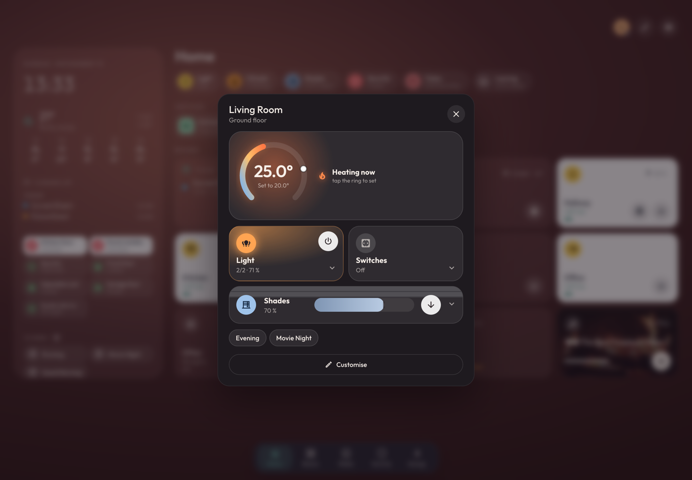<br><sub>Fenêtre de la pièce : anneau de température, lumière, volets, interrupteurs et scènes.</sub></td>
    <td width="50%">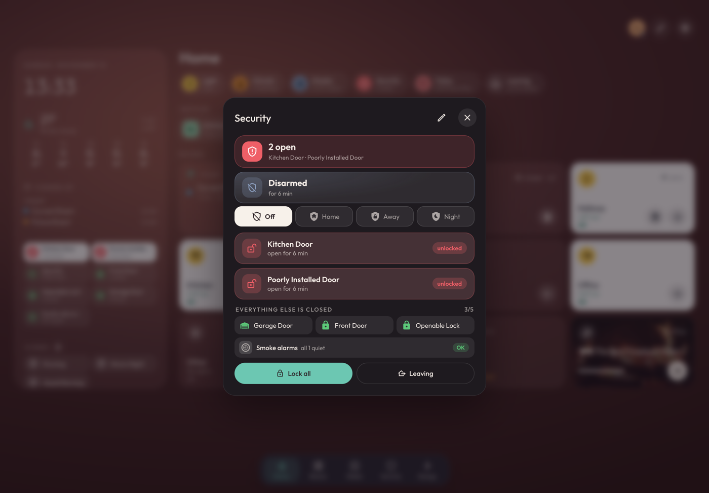<br><sub>Sécurité : ce qui est ouvert, l'alarme, les détecteurs de fumée, tout verrouiller.</sub></td>
  </tr>
  <tr>
    <td width="50%">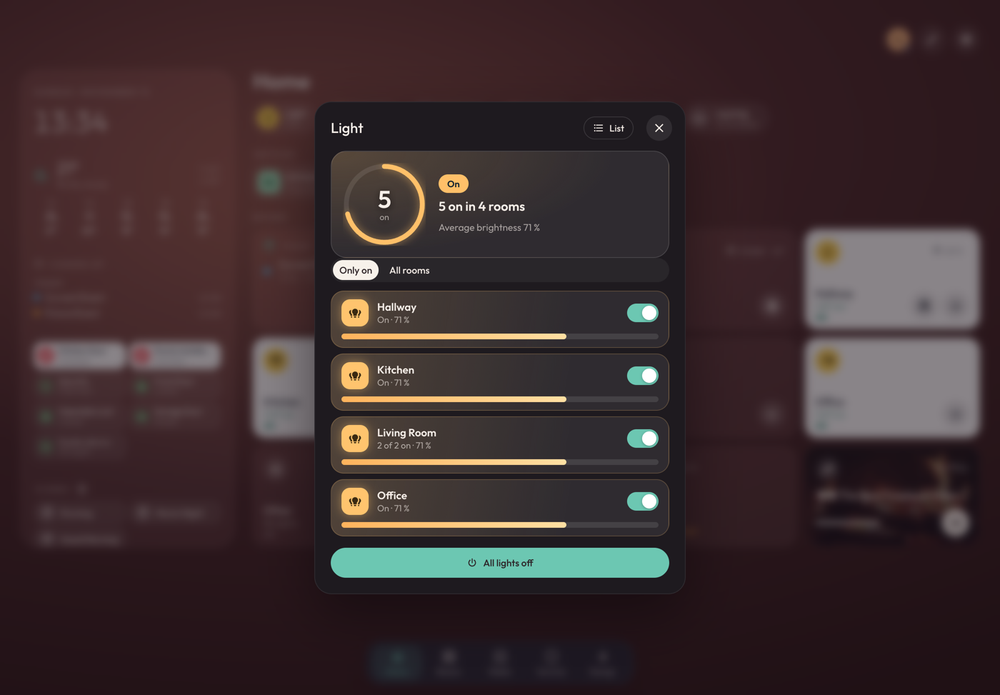<br><sub>Un appui sur <i>Lumière</i> : toutes les lampes allumées, par pièce.</sub></td>
    <td width="50%">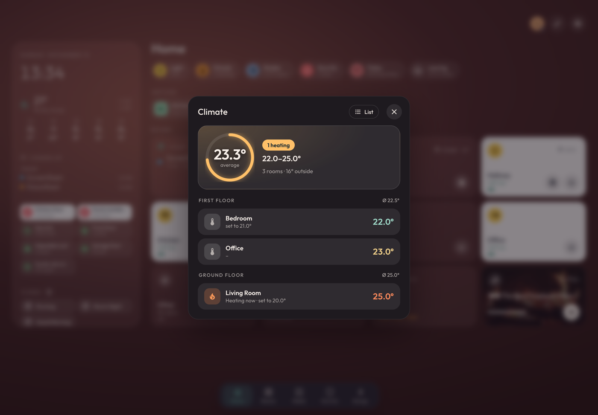<br><sub>Un appui sur <i>Climat</i> : la température et la consigne de chaque pièce.</sub></td>
  </tr>
  <tr>
    <td width="50%">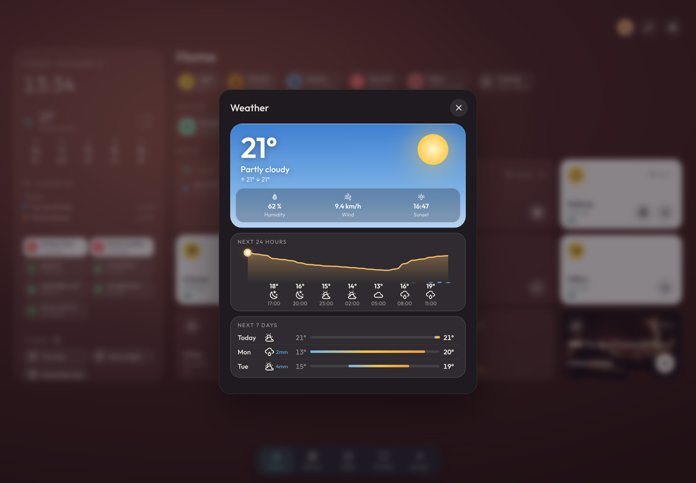<br><sub>La météo sur un seul écran, sans défilement.</sub></td>
    <td width="50%">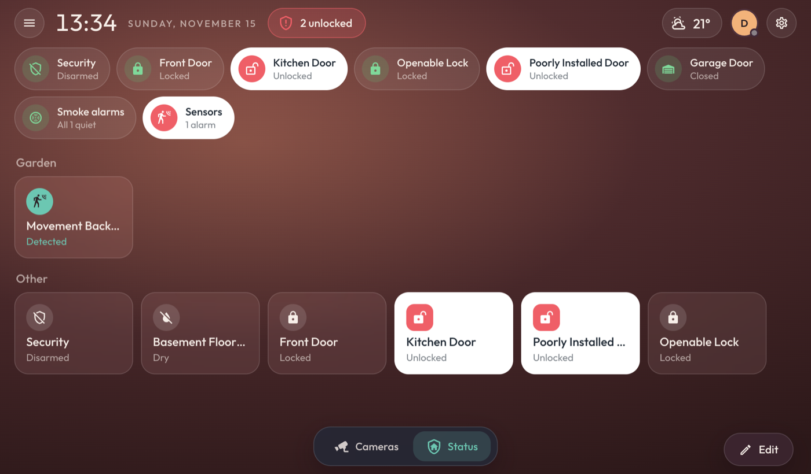<br><sub>SecurityPanel : la page d'état après les pages de caméras.</sub></td>
  </tr>
</table>

## Réglages

L'engrenage en haut à droite ouvre les réglages. Chaque onglet commence par une ligne qui explique à quoi il sert, et la note en dessous indique à qui s'applique un changement : cet écran, vous, ou tout le monde.

| Onglet | Ce que vous y réglez |
|---|---|
| **Accueil** | Style de l'accueil, pastilles d'état affichées (y compris Déchets), cartes de l'accueil, date, météo et calendrier dans l'en-tête |
| **Pièces et appareils** | Ce qu'ouvre un appui sur une pièce (aperçu de la pièce ou page complète), mouvements dans la fenêtre de la pièce (pour vous seul), confirmation des scènes, une seule tuile pour tous les volets d'une pièce |
| **Sécurité** | Portes, portails et serrures surveillés et leur ordre, plages d'ouverture autorisée de chacun, caméras (page Sécurité pour tout le monde, derniers mouvements pour vous seul), parties de la fenêtre Sécurité, vérification de bonne nuit, sonnette, babyphone |
| **Apparence** | Couleur des cartes, couleur d'accent, arrière-plan (il peut suivre la couleur des lumières allumées), coins, effet verre, fenêtres classiques |
| **Cet écran** | Disposition, taille des tuiles, panneau latéral, masquer la barre latérale de Home Assistant, effets (mode allégé pour les tablettes lentes), caméras par page |
| **Navigation** | Onglets affichés dans la barre du bas, vos propres pages |
| **Calendrier et météo** | Calendriers et listes utilisés, source météo (Open-Meteo si vous n'en avez pas) |
| **Masquage** | Entités une par une, règles de texte, types d'appareils, intégrations |
| **Système** | Vos propres réglages pour ce panneau, sauvegarde et restauration dans un fichier, reprise des réglages d'un autre panneau (réglages de la maison ou tout), ouvrir HausPanel en premier au démarrage de Home Assistant, verrouillage des modifications (administrateurs seulement ou code PIN), informations pour un rapport de bug, réafficher la fenêtre de bienvenue |

<table>
  <tr>
    <td width="50%">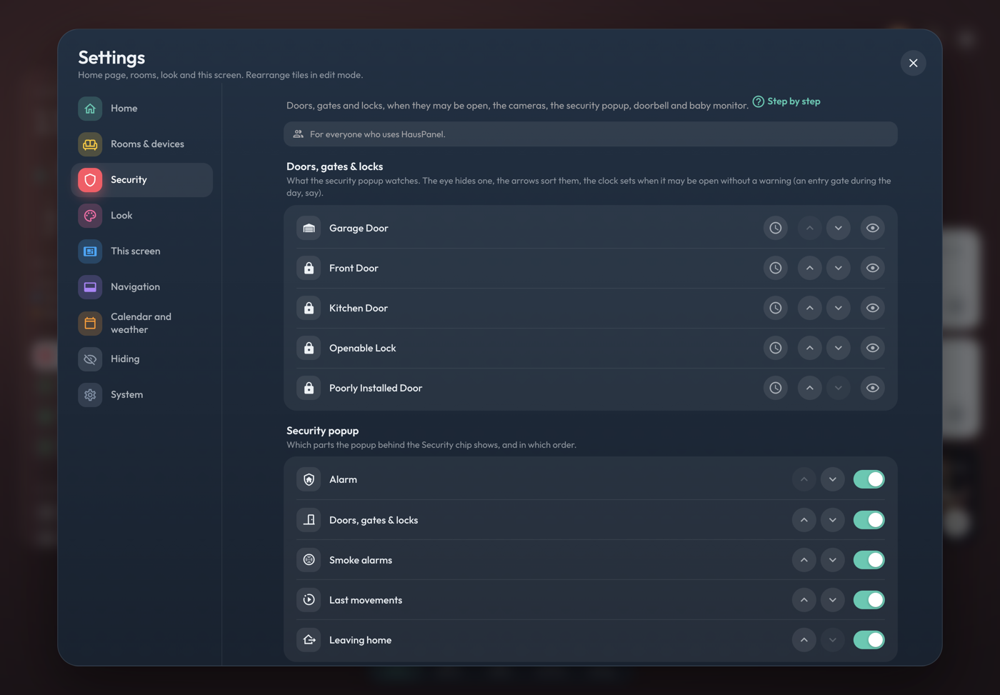<br><sub>Réglages → Sécurité : portes surveillées, plages d'ouverture autorisée, parties de la fenêtre.</sub></td>
    <td width="50%">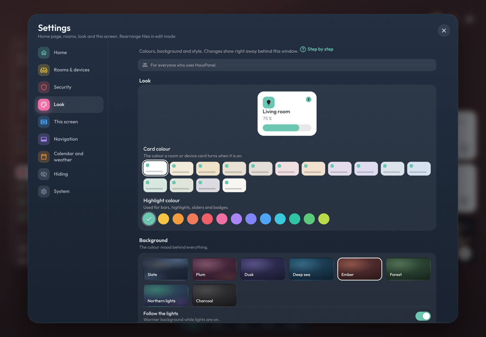<br><sub>Réglages → Apparence : couleurs et arrière-plan, visibles en direct derrière la fenêtre.</sub></td>
  </tr>
</table>

**Pas à pas :** de courts guides pour les tablettes murales, les téléphones, le portail qui peut rester ouvert en journée, les caméras, le masquage et plus encore se trouvent dans [docs/guides.md](docs/guides.md) (en anglais). Chaque onglet des réglages renvoie vers le guide qui lui correspond.

## Installation

### Avec HACS (recommandé)

1. HACS → les trois points → **Dépôts personnalisés** → ajoutez `https://github.com/alpacalabs-de/hauspanel` avec le type **Intégration**.
2. Installez **HausPanel** et redémarrez Home Assistant.
3. **Paramètres → Appareils et services → Ajouter une intégration → HausPanel**.

### À la main

Téléchargez la dernière [version](https://github.com/alpacalabs-de/hauspanel/releases), copiez `custom_components/hauspanel` dans le dossier `custom_components` de votre configuration Home Assistant, redémarrez, puis ajoutez l'intégration comme ci-dessus.

Nécessite Home Assistant 2024.7 ou plus récent (testé avec les versions 2026.10 et 2026.11).

## Premiers pas

1. **Pièces et étages** : rattachez vos appareils à des zones, et les zones à des étages, dans *Paramètres → Zones, étiquettes et zones géographiques*. C'est à partir de cela que HausPanel se construit.
2. Ouvrez **HausPanel** dans la barre latérale. Sur un téléphone, utilisez **MobilePanel**.
3. Ouvrez les **réglages** (engrenage) et parcourez les onglets de gauche à droite. Sur une tablette murale, commencez par *Cet écran* et activez *Masquer la barre latérale de Home Assistant*.
4. Quelque chose que vous ne voulez pas voir ? **Réglages → Masquage**, ou le crayon (mode édition) puis le signe moins sur une tuile.
5. Vous voulez que HausPanel s'ouvre en premier ? **Réglages → Système → Écran de démarrage** dans HausPanel, pour vous ou (en tant qu'administrateur) pour tout le monde.

## Bon à savoir

- **Où sont mes réglages ?** Dans Home Assistant, dans `.storage/hauspanel.settings*`. Ils font partie de chaque sauvegarde de Home Assistant.
- **La page Énergie est vide ?** Elle utilise les sources et le prix définis dans *Paramètres → Tableaux de bord → Énergie*. Les statistiques à long terme ont besoin de quelques heures après leur mise en place.
- **Les caméras** utilisent le flux de Home Assistant lui-même (WebRTC, HLS ou MJPEG). Les derniers mouvements dans la fenêtre Sécurité nécessitent l'[intégration Frigate](https://github.com/blakeblackshear/frigate-hass-integration).
- **La rotation de l'écran sur iPhone** ne peut pas être bloquée par une page web. Utilisez le verrouillage de l'orientation dans le Centre de contrôle.
- **Après une mise à jour**, redémarrez Home Assistant : recharger l'intégration ne suffit pas. HausPanel le rappelle aux administrateurs avec un bouton *Redémarrer*. Si un écran affiche encore l'ancienne version, rechargez-le ; dans l'application Home Assistant, videz le cache de l'interface (*Paramètres → Application compagnon → Dépannage*).
- Police : Outfit (licence SIL Open Font License), fournie dans `frontend/fonts/`.

## Développement

Il n'y a pas d'étape de compilation : l'interface est faite de simples modules JavaScript dans `custom_components/hauspanel/frontend/`.

```bash
python3 -m venv .venv-ha && .venv-ha/bin/pip install homeassistant
HAUSPANEL_DEV=1 .venv-ha/bin/hass -c ha-config
```

`HAUSPANEL_DEV=1` sert l'interface sans mise en cache. Sans cette variable, un identifiant de build (version + empreinte des fichiers) dans le chemin oblige les navigateurs à charger le nouveau code après une mise à jour. Les captures d'écran proviennent de l'intégration de démonstration de Home Assistant.

- `__init__.py` : les trois panneaux, la mise à disposition de l'interface, l'API websocket des réglages (par panneau, et en option par utilisateur)
- `frontend/hauspanel.js` : le panneau (en-tête, pages, barre)
- `frontend/lib/` : `model.js` (zones → appareils → entités), `domains.js` (ce que fait un appui), `tile.js`, `layouts.js`, `phone.js`, `securitypanel.js`, `roompop.js`, `overviews.js` (les fenêtres des pastilles), `settings.js`, `store.js`, `i18n.js` (anglais et allemand) avec `lang/` (les autres langues), `styles.js` et un fichier par fenêtre d'appareil

**Tests :** `node --test "tests/*.test.mjs"` (Node 22 ou plus récent, rien à installer). Ils vérifient les plages horaires des portes et portails, la pièce dans laquelle arrive un appareil, le masquage, les curseurs des volets, l'alerte météo, et que chaque langue contient chaque texte avec les mêmes paramètres. GitHub les lance à chaque push. Une nouvelle clé de texte doit avoir une entrée dans chaque fichier de langue, sinon les tests échouent.

Bugs et idées sont les bienvenus dans les [issues](https://github.com/alpacalabs-de/hauspanel/issues/new/choose) ; le formulaire demande tout de suite la version, le panneau et la disposition. *Réglages → Système → Informations pour un rapport de bug* copie tout cela en une seule fois.

## Aider aux traductions

L'anglais et l'allemand sont rédigés à la main. Le français, le néerlandais, l'espagnol, l'italien, le polonais, le suédois et le turc ont été traduits automatiquement : le regard d'une personne dont c'est la langue maternelle aide beaucoup.

- **Signalez-le simplement :** ouvrez une [issue de traduction](https://github.com/alpacalabs-de/hauspanel/issues/new?template=translation.yml) avec le texte que vous avez vu et votre meilleure formulation.
- **Modifiez-le vous-même :** chaque langue tient dans un fichier, `custom_components/hauspanel/frontend/lib/lang/<code>.js` (une ligne par texte, `clé: "texte"`). Modifiez le texte sur GitHub (icône crayon) et proposez la modification. Gardez tels quels les mots entre `{accolades}` : HausPanel les remplit. Les textes de configuration sont dans `custom_components/hauspanel/translations/<code>.json`.
- **Une nouvelle langue :** copiez un fichier de `lang/`, traduisez-le, ajoutez son code à `LANGS` dans `i18n.js` et ajoutez `translations/<code>.json`. `node --test "tests/*.test.mjs"` vous signale s'il manque un texte.

## Soutenir

HausPanel est gratuit et le restera. S'il vous fait gagner du temps, vous pouvez nous offrir un café :

<a href="https://ko-fi.com/alpacalabs"></a>

Une étoile sur GitHub, un rapport de bug ou une idée dans les [issues](https://github.com/alpacalabs-de/hauspanel/issues) aide tout autant.

## Comment il est fait

HausPanel est écrit avec beaucoup d'aide de l'IA (Claude). Les idées, les choix de conception et les tests viennent de son utilisation quotidienne sur notre propre tablette murale et nos téléphones. Chaque version passe par des tests automatiques et sert dans une vraie maison avant d'être publiée. Si quelque chose ne fonctionne pas chez vous, [ouvrez une issue](https://github.com/alpacalabs-de/hauspanel/issues) : c'est comme ça qu'il s'améliore.

## Licence

MIT © 2026 Alpaca Labs. Voir [LICENSE](LICENSE).
